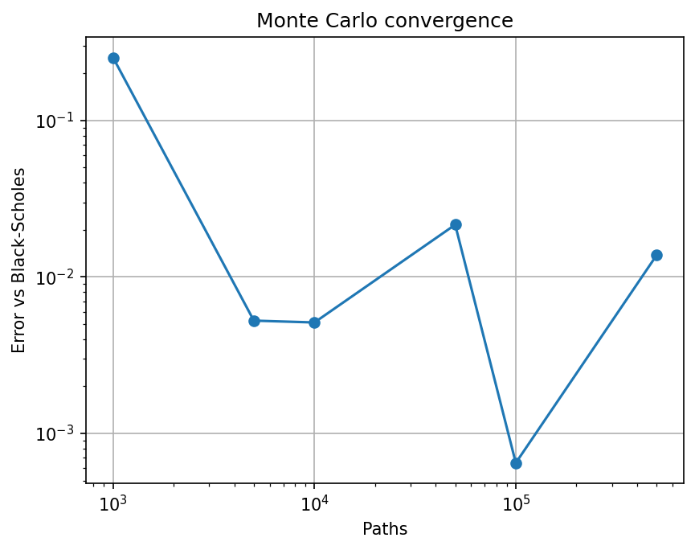
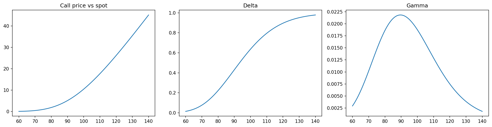

# Option Pricer

Python implementation of European option pricing and risk measures.

## What it does
- Black-Scholes price and Greeks (delta, gamma, vega) for calls and puts
- Monte Carlo pricer with antithetic variates and standard error
- Implied volatility solver (Brent's method)
- Tests: put-call parity, Monte Carlo vs Black-Scholes, finite-difference delta, implied volatility recovery

## Results

## How to run
Open `option_pricer.ipynb` in Google Colab and choose Runtime → Run all.
